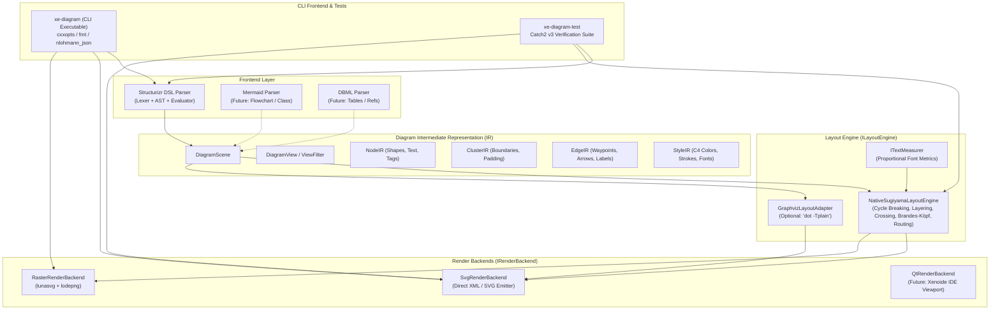

# Architecture Design & Implementation Plan: High-Performance Self-Contained Structurizr DSL Renderer (`xe-diagram`)

## 1. Goal Description

The goal of this project is to research, design, and architect a **self-contained, native C++ tool (`xe-diagram`)** capable of rapidly parsing and rendering **Structurizr DSL** files into high-quality visual diagrams (SVG and PNG).

### The Problem
Currently, the Structurizr ecosystem relies on Java (Structurizr CLI / Java SDK) and headless browser automation (Puppeteer / Chromium / Playwright) or cloud services (Kroki) to render diagrams to SVG or PNG. This introduces:
1. **Heavy runtime dependencies**: Requires JDK 17+, Node.js, npm, or Docker.
2. **Slow startup and render times**: Cold starts take 3 to 10 seconds per execution.
3. **Fragile integration**: Difficult to embed directly into lightweight CI pipelines, native desktop IDEs (like Xenoide), or command-line developer workflows.

### The Solution
`xe-diagram` is an in-tree native C++17 tool and library suite designed to:
- **Parse Structurizr DSL natively** via a handcrafted, zero-dependency recursive-descent parser and lexer (< 2 ms).
- **Compute hierarchical graph layout** using an embedded, self-contained implementation of the **Sugiyama framework** with compound cluster / boundary support (< 10 ms).
- **Render directly to SVG** (< 1 ms) and optionally rasterize to **PNG** via lightweight `lunasvg` / `plutovg` without requiring any browser or graphics server.
- **Support future DSLs** (Mermaid flowchart/class diagrams, DBML database schemas) by decoupling the DSL frontend from the core **Diagram Intermediate Representation (IR)**.
- Concur strictly with Xenoide architectural standards: **C++17**, Conan 2.x, CMake 3.25+, Catch2 v3, zero warnings (`-Wall -Wextra -Werror`).

---

## 2. Library Research & Technology Evaluation

To achieve a truly self-contained, high-performance tool, every stage of the diagram pipeline was evaluated across existing open-source and ConanCenter libraries:

```
+--------------------------------------------------------------------------------------------------+
|                                    xe-diagram Pipeline Layers                                    |
+--------------------------------------------------------------------------------------------------+
| 1. Frontend: DSL Parsing     | Handcrafted Lexer & Recursive Descent Parser (Zero external deps) |
| 2. Semantic Model & IR       | DiagramScene IR (Nodes, Clusters/Boundaries, Edges, Styles)       |
| 3. Layout Engine             | Native C++ Sugiyama Layout Engine + Optional Graphviz Dot Adapter |
| 4. Text & Font Metrics       | Built-in Proportional Font Metrics Table (+ Optional FreeType2)  |
| 5. Renderers                 | SvgRenderBackend (Native C++) + RasterRenderBackend (lunasvg/PNG) |
| 6. CLI Driver & Output       | cxxopts + fmt + nlohmann_json                                     |
+--------------------------------------------------------------------------------------------------+
```

### 2.1 Parser & Frontend Evaluation

| Approach | Dependencies | Speed | Diagnostics / Errors | Verdict |
| :--- | :--- | :--- | :--- | :--- |
| **Handcrafted Lexer + Recursive Descent** | None (C++17 Standard Library) | **< 2 ms** (instant) | Exact line/col pointers with source spans | **Selected (Primary)**: Clean, zero-dependency, easiest to extend and maintain within Xenoide. |
| **Tree-sitter (`tree-sitter-structurizr`)** | Tree-sitter C runtime + generated C parser | ~5 ms | Good syntax trees, weaker semantic error handling | Feasible alternative, but adds build complexity and external generated C code. |
| **TaoPEGTL (`taocpp-pegtl`)** | Header-only (in ConanCenter) | ~10 ms | Template bloat, harder compiler error messages | Rejected: Heavy template compilation cost. |
| **CLI / Java JSON Bridge** | Java JRE / CLI subprocess | > 3000 ms | Relies on external Java process | Rejected: Violates "self-contained" requirement. |

### 2.2 Graph Layout Engine Evaluation

Layout is the hardest algorithmic phase of diagram generation. Structurizr views are hierarchical directed graphs with nested boundary clusters (Software System boundaries, Container boundaries).

| Engine | Type | Self-Contained? | Cluster / Boundary Support | Verdict |
| :--- | :--- | :--- | :--- | :--- |
| **Native C++ Sugiyama Engine** | In-tree C++17 modular layout | **Yes** (0 runtime deps) | **Yes** (designed specifically for C4 boundaries) | **Selected (Default Engine)**: Instant execution, zero external tools needed on Windows/Linux/macOS. |
| **Graphviz Subprocess Adapter (`dot`)** | External process invocation | No (requires `dot` on PATH) | Excellent (`subgraph cluster_...`) | **Selected (Optional Engine)**: Useful as a `--layout=graphviz` flag when identical Graphviz coordinates are desired. |
| **`bigno78/drag`** | Header-only C++17 (BSD-3) | Yes | Basic DAGs; no compound cluster/boundary support | Evaluated as reference implementation of Brandes-Köpf coordinate assignment. |
| **OGDF** | Massive C++ framework | Yes (if compiled) | Yes | Rejected: Not in ConanCenter, 100k+ LOC, high build friction. |
| **Adaptagrams (`libavoid`)** | C++ connector routing | Yes | Orthogonal edge routing | Potential future addition for advanced obstacle-avoiding edge routing. |

### 2.3 Rendering & Output Engine Evaluation

| Backend | Output Format | Dependencies in ConanCenter | Speed | Quality |
| :--- | :--- | :--- | :--- | :--- |
| **Native C++ SVG Emitter** | `.svg` | **None** (zero dependencies) | **< 1 ms** | Vector, crisp at any scale, CSS stylable, interactive |
| **`lunasvg` (v3.5.0) + `lodepng`** | `.png` | `lunasvg`, `plutovg`, `lodepng` | **~5 ms** | Pixel-perfect rasterization without headless Chrome |
| **Cairo / Skia** | `.png`, `.pdf` | Heavy (X11/fontconfig/glib or multi-GB Skia) | ~15 ms | High, but massive footprint |
| **Headless Puppeteer / Chromium** | `.svg`, `.png` | Node.js, Chromium (150+ MB) | > 2500 ms | Standard Structurizr, but extremely heavy |

---

## 3. System Architecture & Component Decomposition

The tool is structured into 4 static libraries and 1 CLI executable inside `src/diagram/`:



### Module Responsibilities:

1. **`libxe-diagram-core`**:
   - Fundamental types: `Point`, `Size`, `Rect`, `Color`, `ShapeKind`, `StrokeStyle`.
   - Diagram IR: `DiagramWorkspace`, `DiagramView`, `NodeIR`, `ClusterIR`, `EdgeIR`.
   - Interfaces: `IDiagramFrontend`, `ILayoutEngine`, `IRenderBackend`, `ITextMeasurer`.
2. **`libxe-diagram-structurizr`**:
   - `Lexer`: Tokenizes Structurizr DSL (`workspace`, `model`, `views`, `styles`, identifiers, strings, arrows `->`).
   - `Parser`: Builds AST respecting `!identifiers hierarchical` and nested blocks.
   - `SemanticEvaluator`: Resolves relationships, expands `include *` / `exclude` view rules, evaluates software system / container containment boundaries, and binds element/relationship styles.
3. **`libxe-diagram-layout`**:
   - `FontMetrics`: Embedded proportional character width tables for Helvetica/Roboto/Arial with multi-line text wrapping and padding calculations.
   - `NativeSugiyamaLayout`:
     - Phase 1: Cycle breaking via greedy feedback arc set (DFS).
     - Phase 2: Rank assignment (longest path / network simplex) with dummy node insertion for multi-rank edges.
     - Phase 3: Crossing reduction (two-layer barycenter sweeps with cluster contiguity constraints).
     - Phase 4: Coordinate assignment (Brandes & Köpf horizontal alignment, cluster bounding box expansion).
     - Phase 5: Edge routing (orthogonal polyline or cubic bezier splines with arrowheads and label positions).
   - `GraphvizDotLayout`: Optional layout backend that formats the graph to DOT with clusters, executes `dot -Tplain`, and parses coordinates back into the IR.
4. **`libxe-diagram-render`**:
   - `SvgRenderBackend`: High-performance SVG generation:
     - C4 shapes: `Box`, `RoundedBox`, `Person` (head circle + body), `Cylinder` (database), `Component`, `Folder`.
     - Software system / Container boundary boxes with dashed lines and top-left header tabs.
     - Arrowheads (filled SVG markers) and label pill backgrounds.
   - `RasterRenderBackend`: Renders generated SVG to PNG using `lunasvg` and saves via `lodepng`.
5. **`xe-diagram` (CLI Executable)**:
   - CLI flags:
     - `xe-diagram <input.dsl> [options]`
     - `--view <key>`: Render specific view (or all views if omitted).
     - `--format <svg|png>`: Output format (default: `svg`).
     - `--output <dir|file>`: Target file or output directory.
     - `--layout <native|graphviz>`: Choose layout algorithm (default: `native`).
     - `--list-views`: Print all available views in the workspace.
     - `--export-json`: Export normalized Structurizr JSON workspace.
6. **`xe-diagram-test`**:
   - Catch2 unit tests covering lexer tokens, AST nodes, view selection logic, layout coordinates, SVG syntax correctness, and end-to-end rendering of `docs/plans/CMAKE_STYLE_CHECKER_V2.2.dsl`.

---

## 4. Diagram Intermediate Representation (IR)

The Diagram IR is the shared abstraction that decouples frontends (Structurizr, Mermaid, DBML) from backends (SVG, PNG, Qt):

```cpp
namespace xe::diagram {

    enum class ShapeKind {
        Box,
        RoundedBox,
        Person,
        Cylinder,
        Component,
        Folder,
        WebBrowser,
        MobileDeviceLandscape,
        MobileDevicePortrait
    };

    struct ElementStyle {
        std::string background = "#1168BD";
        std::string color = "#ffffff";
        std::string stroke = "#0b4884";
        int strokeWidth = 2;
        ShapeKind shape = ShapeKind::RoundedBox;
        int opacity = 100;
        int fontSize = 14;
    };

    struct RelationshipStyle {
        std::string color = "#707070";
        int thickness = 2;
        bool dashed = false;
        int fontSize = 12;
    };

    struct NodeIR {
        std::string id;
        std::string displayName;
        std::string technology;
        std::string description;
        std::vector<std::string> tags;
        ElementStyle style;
        
        // Layout geometry (computed by ILayoutEngine)
        Rect bounds{0, 0, 0, 0};
        std::string parentClusterId; // empty if top-level
    };

    struct ClusterIR {
        std::string id;
        std::string title;
        std::string typeLabel; // e.g. "[Software System]", "[Container]"
        std::vector<std::string> childrenNodeIds;
        std::string parentClusterId;
        
        // Computed boundary bounds (enclosing children + padding + header)
        Rect bounds{0, 0, 0, 0};
    };

    struct EdgeIR {
        std::string id;
        std::string sourceId;
        std::string targetId;
        std::string description;
        std::string technology;
        RelationshipStyle style;

        // Computed routing geometry
        std::vector<Point> waypoints; // Bend points
        Point labelPosition{0, 0};
    };

    enum class LayoutDirection {
        TopToBottom, // tb
        BottomToTop, // bt
        LeftToRight, // lr
        RightToLeft  // rl
    };

    struct DiagramView {
        std::string key;
        std::string title;
        std::string description;
        LayoutDirection direction = LayoutDirection::TopToBottom;
        int rankSeparation = 60;
        int nodeSeparation = 40;

        std::vector<ClusterIR> clusters;
        std::vector<NodeIR> nodes;
        std::vector<EdgeIR> edges;
        Rect totalBounds{0, 0, 0, 0};
    };

    struct DiagramWorkspace {
        std::string name;
        std::string description;
        std::vector<DiagramView> views;
    };

} // namespace xe::diagram
```

### Extensibility to Mermaid & DBML:
- **Mermaid Flowchart**: Nodes become `NodeIR`, subgraphs become `ClusterIR`, connections `-->` become `EdgeIR`, direction `TD`/`LR` maps to `LayoutDirection`.
- **DBML Schema**: Each `Table` becomes a `NodeIR` (with fields formatted as multiline text or sub-cells), `TableGroup` becomes `ClusterIR`, `Ref` foreign keys become `EdgeIR`.

---

## 5. Layout Engine: Clustered Sugiyama Algorithm

C4 diagrams require structured, readable alignment where nodes inside the same system/container boundary are grouped together, and external actors (people, outside services) sit cleanly on the boundaries.

```
       [Developer] (Person)
            |
            | CLI
            v
+----------- xe-cmake (Software System Boundary) -------------------+
|                                                                   |
|   +-------------------+          +--------------------+           |
|   | xe-cmake-checker  | -------> | xe-cmake-refactor  |           |
|   +-------------------+          +--------------------+           |
|             |                                                     |
|             v                                                     |
|   +-------------------------------+                               |
|   | libxe-cmake-checker-rule-eng  |                               |
|   +-------------------------------+                               |
|             |                                                     |
|             v                                                     |
|   +-------------------------------+                               |
|   |   libxe-cmake-checker-core    |                               |
|   +-------------------------------+                               |
+-------------------------------------------------------------------+
            |
            | File I/O
            v
   [Target CMake Project Tree] (External System)
```

### Layout Execution Steps:
1. **Size Computation**: For each node, measure text lines (`title`, `technology`, `description`), wrap description to a target width (default ~240px), and compute required node dimensions (`width`, `height`). Minimum node size: 200×120px for components/containers.
2. **Cycle Removal**: Apply Greedy Feedback Arc Set to reverse backward edges and obtain a DAG.
3. **Layer / Rank Assignment**: Assign integer layers $0 \dots k$ using Longest Path. Multi-rank edges are split with dummy nodes so edges span exactly 1 layer.
4. **Cluster Rank Alignment**: Ensure all nodes within a cluster share a contiguous layer span.
5. **Crossing Reduction**: Alternating forward and backward sweeps using the Barycenter heuristic. Nodes belonging to the same cluster are constrained to stay adjacent within their layer.
6. **Brandes & Köpf Horizontal Coordinate Assignment**:
   - Align nodes vertically with their predecessors to generate straight edges.
   - Expand cluster boundaries: For each cluster, its rectangle is computed as $\bigcup \text{children bounds} + \text{padding}$ (top padding includes header title).
   - If two clusters or top-level nodes collide, apply horizontal shifting with `nodeSeparation`.
7. **Edge Routing & Waypoint Generation**:
   - Connected via dummy nodes.
   - Straight lines for single-rank direct connections; 3-segment orthogonal polylines or smooth cubic splines for multi-rank jumps.
   - Compute boundary intersection point so arrowheads touch the perimeter of shapes (circles for persons, rounded rects for boxes).

---

## 6. Proposed Directory Structure & Conan Configuration

The new subsystem will be created in `src/diagram/` following the existing Xenoide structure:

```
src/diagram/
├── CMakeLists.txt
├── conanfile.py
└── src/
    ├── libxe-diagram-core/
    │   ├── CMakeLists.txt
    │   └── src/
    │       ├── Types.h
    │       ├── DiagramIR.h
    │       ├── Interfaces.h
    │       └── Geometry.h
    ├── libxe-diagram-structurizr/
    │   ├── CMakeLists.txt
    │   └── src/
    │       ├── Lexer.h / Lexer.cpp
    │       ├── Ast.h
    │       ├── Parser.h / Parser.cpp
    │       └── StructurizrFrontend.h / StructurizrFrontend.cpp
    ├── libxe-diagram-layout/
    │   ├── CMakeLists.txt
    │   └── src/
    │       ├── FontMetrics.h / FontMetrics.cpp
    │       ├── SugiyamaLayout.h / SugiyamaLayout.cpp
    │       └── GraphvizDotLayout.h / GraphvizDotLayout.cpp
    ├── libxe-diagram-render/
    │   ├── CMakeLists.txt
    │   └── src/
    │       ├── SvgRenderer.h / SvgRenderer.cpp
    │       └── PngRenderer.h / PngRenderer.cpp
    ├── xe-diagram/
    │   ├── CMakeLists.txt
    │   └── src/
    │       └── Main.cpp
    └── xe-diagram-test/
        ├── CMakeLists.txt
        └── src/
            ├── LexerTest.cpp
            ├── ParserTest.cpp
            ├── LayoutTest.cpp
            ├── SvgRenderTest.cpp
            └── IntegrationTest.cpp
```

### `conanfile.py` Dependencies:
- `fmt/[>=11 <12]`
- `cxxopts/3.3.1`
- `nlohmann_json/3.12.0`
- `lunasvg/3.5.0`
- `plutovg/1.3.2`
- `catch2/3.14.0` (when `with_tests=True`)

---

## 7. Verification Plan

### Automated Tests (`xe-diagram-test`)
1. **Lexer & Parser Tests**:
   - Verify tokenization of comments (`//`, `/* */`, `#`), quoted strings with escapes, keywords, and arrow operators (`->`).
   - Parse hierarchical identifiers (`xeCmake.xe_cmake_checker.cli_opts`).
   - Parse view definitions (`systemContext`, `container`, `component`, `autoLayout`).
   - Parse element and relationship styling rules.
2. **Layout Engine Tests**:
   - Verify cycle removal produces a valid DAG.
   - Verify layering invariants: $\text{rank}(\text{target}) > \text{rank}(\text{source})$.
   - Verify boundary bounding boxes strictly enclose all children nodes with padding.
   - Verify non-overlapping horizontal node coordinates.
3. **Render Engine Tests**:
   - Verify output SVG is well-formed XML with valid `<svg>`, `<rect>`, `<path>`, `<text>`.
   - Verify PNG generation produces non-empty, valid PNG header bytes via `lunasvg`.
4. **End-to-End Regression Test**:
   - Execute `xe-diagram docs/plans/CMAKE_STYLE_CHECKER_V2.2.dsl --output /tmp/test_views/`.
   - Verify that all 10 views defined in `CMAKE_STYLE_CHECKER_V2.2.dsl` (`SystemContext`, `Containers`, `CheckerCliComponents`, `RuleEngineComponents`, `DslComponents`, `ScriptComponents`, `AnalysisComponents`, `IoComponents`, `CoreComponents`, `TestingComponents`) render cleanly to valid SVG files without errors in under 50 ms total!

### Manual Verification
- View generated SVGs in a browser or vector image viewer to inspect layout aesthetic, line routing, arrowheads, colors, and text readability.

---

## 8. Open Questions & User Review Required

> [!IMPORTANT]
> **Decision 1: Layout Engine Default**
> The design provides a built-in **Native C++ Sugiyama Layout Engine** (zero external dependencies, 100% self-contained) and an optional **Graphviz `dot` Subprocess Adapter** (activated via `--layout=graphviz` if `dot` is installed).
> - *Recommendation*: Default to `native` so the tool works out-of-the-box everywhere without needing Graphviz installed.

> [!IMPORTANT]
> **Decision 2: Subproject Location**
> - Propose placing this tool in `src/diagram/` (with targets `xe-diagram`, `libxe-diagram-*`).
> - An alternative is `src/xe-diagram/` or `src/tools/xe-diagram/`.
> - *Recommendation*: `src/diagram/` matches the naming pattern of `src/engine/` and `src/ide/`.

> [!NOTE]
> **Decision 3: Initial DSL Scope for Iteration 1**
> Iteration 1 will focus on:
> 1. Complete Structurizr DSL: `workspace`, `model` (person, softwareSystem, container, component, group, relationships `->`), `views` (`systemLandscape`, `systemContext`, `container`, `component`, `include *`, `autoLayout`), `styles` (`element`, `relationship`).
> 2. Full SVG export and PNG export.
> 3. Dynamic and Deployment views can be added in a subsequent iteration as they use specialized sequence/infrastructure layout models.
